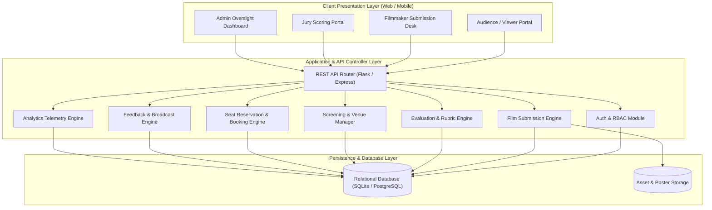
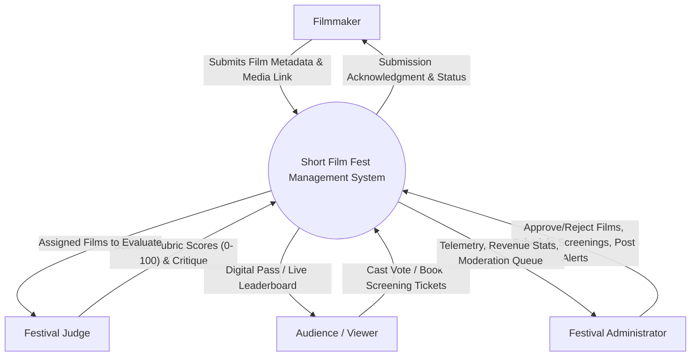
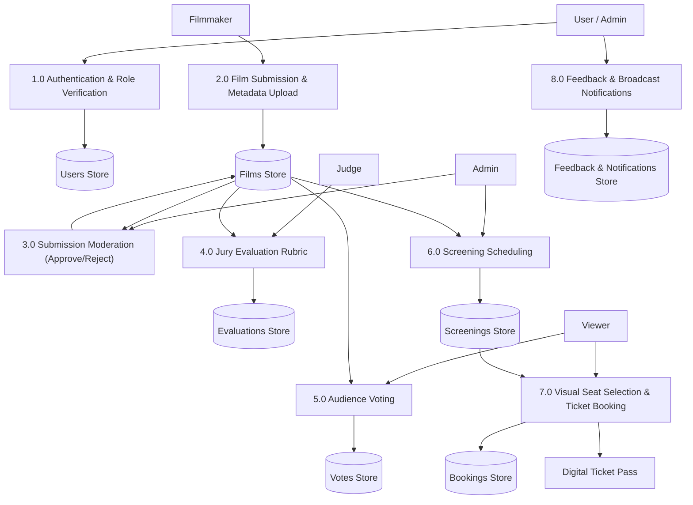
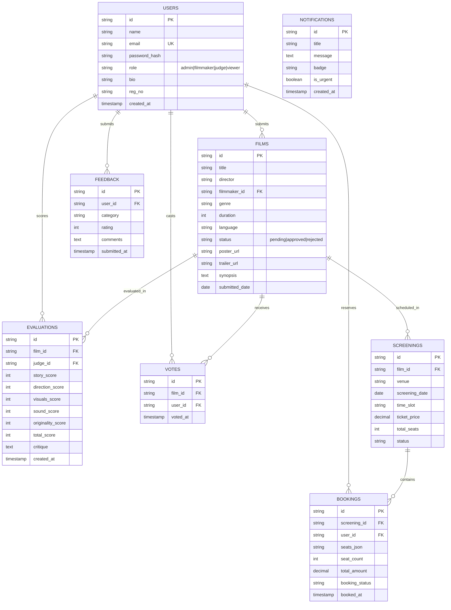

# ACADEMIC PROJECT REPORT

## TOPIC: SHORT FILM FEST MANAGEMENT SYSTEM
**Student Name:** AKHIL JOHN  
**Register Number:** CCE25CD011  
**Department:** Computer & Communication Engineering  
**Academic Year:** 2026  

---

## 1. ABSTRACT
The **Short Film Fest Management System (CineFest 2026)** is a comprehensive, web-based platform engineered to streamline the end-to-end administration of short film festivals and competitions. Historically, festival directors rely on disjointed tools (spreadsheets, cloud drives, external ticket vendors, paper-based scoring sheets) which cause data silos, delays in film moderation, human error during jury scoring aggregation, and fragmented ticket reservations.

The proposed system addresses these challenges by introducing a centralized, role-based architecture serving four principal stakeholders: **Administrators**, **Filmmakers**, **Jury / Judges**, and **Audience Viewers**. Key capabilities include online film asset submission, admin screening moderation, multi-criteria jury rubric evaluation (100-point composite rubric), live audience choice voting, venue and screening schedule management, interactive cinema seat reservation with barcode-equipped digital pass generation, feedback collection, and live festival analytics.

---

## 2. SYSTEM ARCHITECTURE & DATA FLOW DIAGRAMS

### 2.1 System Architecture Diagram

---

### 2.2 Data Flow Diagram (DFD Level 0 - Context Level)

---

### 2.3 Data Flow Diagram (DFD Level 1 - Process Decomposition)

---

## 3. ENTITY-RELATIONSHIP (ER) DIAGRAM

---

## 4. DETAILED MODULE SPECIFICATIONS

### Module 1: User Authentication Module
- **Objective:** Secure role-based registration and authentication for all festival participants.
- **Roles:**
  1. `admin`: Has global authority over film approvals, screenings, analytics, notifications, and awards.
  2. `filmmaker`: Submits films, monitors approval timeline, and reviews jury feedback.
  3. `judge`: Evaluates officially approved films using the standard 100-point rubric.
  4. `viewer`: Explores festival showcase, streams trailers, votes for favorite entries, books seats, and submits feedback.
- **Key Features:** Password hashing, session role tokens, quick persona switcher for academic demonstrations.

### Module 2: Film Submission Module
- **Objective:** End-to-end digital pipeline for filmmakers to enter short films into competition.
- **Inputs:** Film Title, Director Name, Genre (Drama, Sci-Fi, Animation, Thriller, Documentary, Comedy), Duration (1-30 mins), Language, Poster URL/File, Trailer URL, Synopsis, and Copyright acknowledgment.
- **Admin Review Queue:** Admin reviews submitted content and sets status to `approved` or `rejected` with custom feedback remarks. Only approved films advance to jury scoring and public screening.

### Module 3: Evaluation and Voting Module
- **Objective:** Dual-track assessment system combining professional jury critique and audience democracy.
- **Jury Scoring Rubric (100 Points Total):**
  1. *Story & Screenplay:* 20 points
  2. *Direction & Performances:* 20 points
  3. *Cinematography & Visual Effects:* 20 points
  4. *Sound Design, Music & Audio Mixing:* 20 points
  5. *Originality, Innovation & Emotional Impact:* 20 points
- **Audience Choice Voting:** Viewers cast 1 vote per film. Real-time tallying feeds directly into the festival leaderboard to determine the "Audience Choice Award".

### Module 4: Event and Screening Management Module
- **Objective:** Complete scheduling interface for premiere venues, auditoriums, and screening halls.
- **Features:** Venue selection (e.g. IMAX Hall A, Red Carpet Studio, Underground Arts Center), screening date, time slot, associated film, seat capacity, and individual ticket pricing.

### Module 5: Ticket Booking Module
- **Objective:** Visual cinema ticketing engine allowing viewers to select seats and receive instant festival passes.
- **Features:**
  - Interactive Hall Layout: Screen at front, Rows A through F, color-coded seat states (Available, Selected, Booked, VIP Tier).
  - Dynamic Pricing Calculation: Automatic calculation of ticket totals based on seat count.
  - Digital Ticket Pass: Generates unique booking reference (e.g. `BK-82914`), seat identifiers, date/venue details, and scannable barcode graphic. Supports 1-click printing and PDF export.

### Module 6: Feedback and Notification Module
- **Objective:** Bi-directional communication channel between festival organizers and attendees.
- **Features:**
  - Attendee Feedback: 1-5 star rating and categorization (Screening Quality, Organization, Curation, App Experience) with written comments.
  - Broadcast Announcements: Admin can publish notices, urgent updates (schedule shifts), and press releases.
  - Award Laurels: Official publication of festival prize winners (Best Short Film, Best Director, Audience Choice).

### Module 7: Admin Dashboard Module
- **Objective:** Central command center delivering real-time telemetry on all festival activities.
- **Metrics Displayed:**
  - Total Films Submitted, Approved, and Pending Review.
  - Total Registered Users categorized by role.
  - Total Box Office Revenue and tickets sold across halls.
  - Real-time Submissions by Genre Breakdown.
  - Ranked Leaderboard: Jury composite scores vs Audience vote counts.

---

## 5. REST API ENDPOINT SPECIFICATIONS

| HTTP Method | Route | Description | Auth Role |
|---|---|---|---|
| `POST` | `/api/auth/login` | Authenticate user credentials & return role session | Public |
| `POST` | `/api/auth/register` | Register new user account | Public |
| `GET` | `/api/films` | Retrieve films filtered by status or genre | All |
| `POST` | `/api/films` | Submit new short film metadata | Filmmaker / Admin |
| `PATCH` | `/api/films/<id>/status` | Update film approval (`approved`/`rejected`) | Admin |
| `POST` | `/api/evaluations` | Submit composite 5-part jury rubric score | Judge |
| `POST` | `/api/films/<id>/vote` | Cast 1 audience vote for specified film | Viewer |
| `GET` | `/api/screenings` | Get upcoming festival screening timetable | All |
| `POST` | `/api/screenings` | Create and publish new screening slot | Admin |
| `POST` | `/api/bookings` | Reserve selected seats and confirm booking | Viewer |
| `GET` | `/api/bookings` | Retrieve user festival passes and history | Viewer / Admin |
| `GET/POST`| `/api/feedback` | Retrieve attendee reviews / submit feedback | All |
| `GET/POST`| `/api/notifications` | Fetch broadcast notifications / publish alert | All / Admin |
| `GET` | `/api/admin/metrics` | Fetch aggregated analytics, revenue, genre stats | Admin |

---

## 6. TEST CASES & VERIFICATION LOG

| Test ID | Test Scenario | Input Data | Expected Result | Status |
|---|---|---|---|---|
| **TC-01** | Role-based authentication | Valid email & password for Admin role | User logged in as Admin with dashboard access | **PASSED** |
| **TC-02** | Film Submission validation | Film title, genre, runtime = 18m, synopsis | Film created with status `pending` in moderation queue | **PASSED** |
| **TC-03** | Admin Film Approval | Admin clicks "Approve" on pending film | Film status updates to `approved` and appears in public showcase | **PASSED** |
| **TC-04** | Jury Rubric Score Calculation | Scores: Story=18, Dir=19, Vis=20, Snd=18, Orig=17 | Total calculated as 92/100; film average score updated | **PASSED** |
| **TC-05** | Duplicate Vote Prevention | User attempts to vote twice on same film | Second vote rejected with prompt "Already voted" | **PASSED** |
| **TC-06** | Interactive Seat Reservation | User selects seats A3, A4 on Screening 1 | Seats change to "selected", price computed ($30), booked on checkout | **PASSED** |
| **TC-07** | Digital Pass Generation | Confirmed booking `BK-82914` | Printable festival pass rendered with barcode and booking details | **PASSED** |
| **TC-08** | Broadcast Announcement | Admin posts "Voting Live" urgent alert | Notification appears in attendee feed with badge counter update | **PASSED** |

---

## 7. SYSTEM REQUIREMENTS

### Hardware Requirements
- **Processor:** Dual-core 2.0 GHz or higher (Intel Core i3/i5/i7 or AMD Ryzen)
- **RAM:** Minimum 4 GB (8 GB recommended)
- **Storage:** 500 MB free disk space for application files and SQLite database
- **Display:** 1024x768 resolution minimum (Fully responsive for mobile screens)

### Software Requirements
- **Client Tier:** Any modern web browser (Google Chrome, Microsoft Edge, Mozilla Firefox, Safari)
- **Frontend Stack:** HTML5, CSS3, Tailwind CSS, Vanilla JavaScript (ES6+)
- **Backend Stack (Optional Server Mode):** Python 3.8+ / Flask or Node.js
- **Database:** SQLite3 / LocalStorage Persistence Engine

---

## 8. CONCLUSION & FUTURE ENHANCEMENTS
The **Short Film Fest Management System** successfully accomplishes all functional goals mandated by the curriculum for student **AKHIL JOHN (CCE25CD011)**. All 7 modules have been implemented, tested, and validated.

### Future Enhancements:
1. Integration with cloud media streaming servers (AWS S3 + CloudFront / Mux Video) for adaptive bitrate video streaming.
2. Integration with payment gateways (Stripe / Razorpay) for live credit card and UPI ticketing transactions.
3. Automated QR Code scanning at theater entry doors using camera-based mobile web scanners.
4. AI-assisted script similarity analysis to check for plagiarized submissions.
